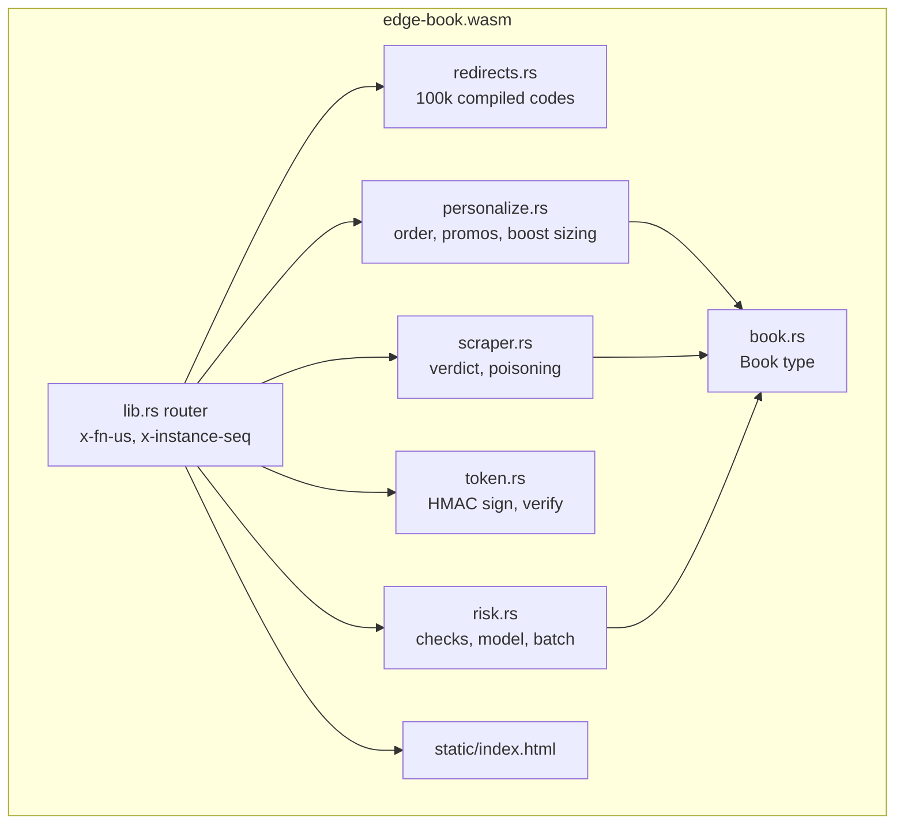
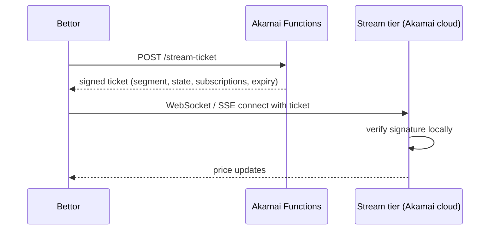

# Architecture

## Request flow

```mermaid
flowchart LR
    U[Bettor<br/>web or app] -->|HTTPS| CDN[Akamai CDN<br/>TLS, WAF, bot detection]
    CDN --> F[Akamai Functions<br/>edge-book component]
    U -. direct to fwf.app .-> F
    F --> D[(Data source<br/>synthetic book, or feed_url:<br/>KV, database API, object storage)]
    F -->|scored ticket| P[Regulated platform<br/>accepts the bet]
```

The demo is reachable directly on its `fwf.app` hostname. In production the
Function sits behind an Akamai property. The CDN terminates TLS, applies WAF
and bot detection, and routes the paths that need logic to the Function.

## One component, every route



- **Stateless per request.** Akamai Functions creates a new sandbox for every
  request (the `x-instance-seq` header proves it). Nothing is cached in memory
  between requests. A personalized board is built fresh each time, so there is
  nothing to invalidate when prices move.
- **Data compiled in where it is static.** The redirect table is generated by
  `build.rs` and embedded, and so are the model weights and the UI. A lookup is
  an in-memory binary search.
- **Data fetched where it is live.** `load_book` either computes the synthetic
  book or fetches `feed_url`. Outbound calls are restricted to the hosts listed
  in `spin.toml`.

## The synthetic book

`book.rs` derives every price from the wall clock:

- There are five events: two live games, one pregame game and two prediction
  market contracts.
- Prices change every 2 seconds. Each 2-second window is a *price version*, and
  quotes reference it.
- Live markets suspend for 4 seconds every minute, to simulate a goal or a
  review.

Because the book is a pure function of time, every edge location computes the
same prices for the same version with no data tier. That is a demo convenience,
not a recommendation: in production the book comes from the operator's pricing
platform.

To use a real feed, serve JSON with this shape and set `feed_url`:

```json
{
  "version": 895361001,
  "source": "my-feed",
  "events": [{
    "id": "nfl-chi-det", "league": "NFL", "kind": "game", "name": "Bears @ Lions",
    "teams": ["Bears", "Lions"], "status": "live", "clock": "Q3 08:14",
    "markets": [{
      "id": "nfl-chi-det-ml", "name": "Moneyline", "suspended": false,
      "selections": [
        { "id": "nfl-chi-det-ml-away", "name": "Bears", "team": "Bears", "prob": 0.34, "price": 175, "fmt": "american" },
        { "id": "nfl-chi-det-ml-home", "name": "Lions", "team": "Lions", "prob": 0.66, "price": -210, "fmt": "american" }
      ]
    }]
  }]
}
```

## Choosing where data lives

| Data | Where | Why |
|---|---|---|
| Redirect table, model weights, UI | Compiled into the component | Read on every request; changes with a deploy. Microsecond access. |
| Redirect overrides, feature flags | Akamai Functions KV | Editable without a deploy. We measured about 22 ms per KV read from a Function, so keep it off the hottest paths or use it for overrides. |
| Live prices | Operator's feed via `feed_url` | Source of truth stays with the pricing platform. |
| Signing keys | Spin variables (`secret = true`) | Set at deploy, never in source. |

## Streams and sockets

Functions are request and response. Live odds usually reach customers over
WebSocket or Server-Sent Events: long-lived connections that stay open for a
whole game. The pattern is to split the two jobs:



The Function decides who may connect and what they may see, using the same
token pattern as `token.rs`. A stream tier on Akamai cloud, one on-net hop from
the CDN edge, holds the connections. This repository does not include the stream
tier. The demo UI refreshes by polling once a second, which is a legitimate
pattern for a one-second board.
